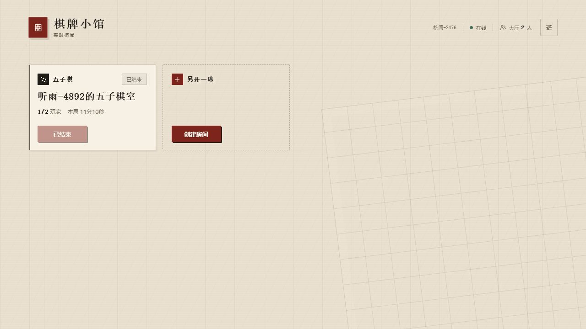
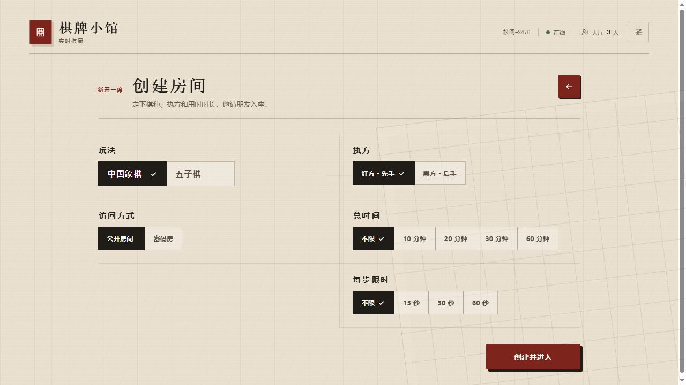
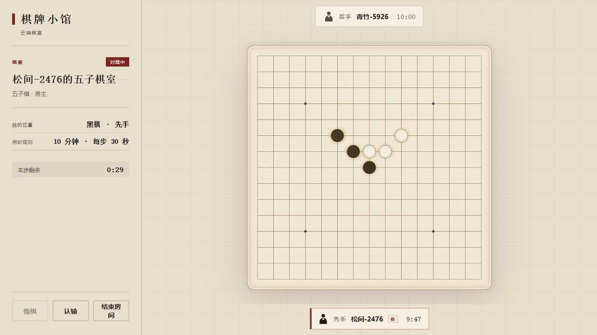
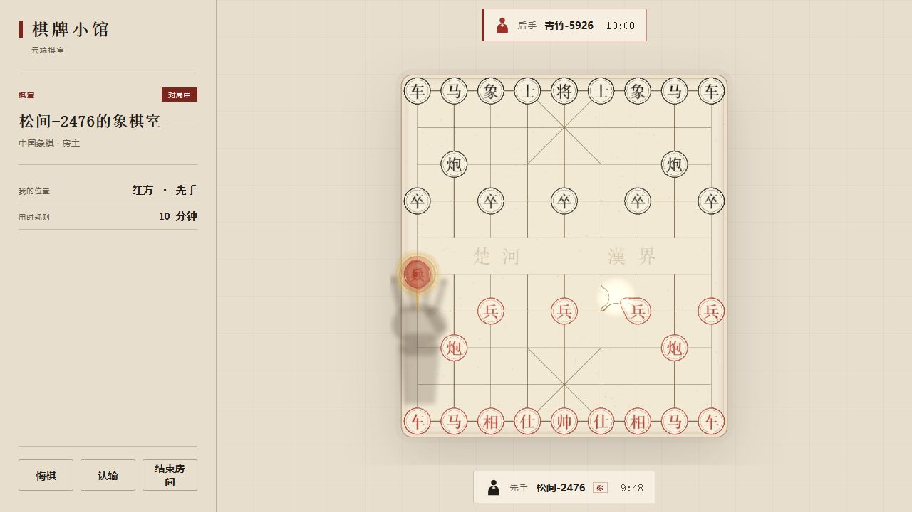

# 棋牌小馆 · DBX Mini Games

一个面向 DBX 的匿名云棋牌大厅。插件是纯前端包，玩家不需要账号，也不需要在本机运行 Sidecar；中国象棋、五子棋、房间、观战和计时由独立 Go 服务统一仲裁。

```text
Publisher: lieng618
Plugin ID: io.github.lieng618.dbx-mini-games
Source:    https://github.com/lieng618/dbx-mini-games
```

## 来源与衍生说明

本项目基于 [southernMortals/dbx-board-games](https://github.com/southernMortals/dbx-board-games) 继续开发，并保留了上游的 Git 历史。当前 `main` 分支中早于 `lieng618` 维护阶段的提交主要由 GitHub 用户 [jzj2621899857](https://github.com/jzj2621899857) 编写。

本仓库不是 GitHub 上的 Fork，而是将上游项目的内容及其提交历史迁入 [lieng618/dbx-mini-games](https://github.com/lieng618/dbx-mini-games) 后继续维护。保留这些提交是为了准确记录项目来源和演进过程。

## 当前能力

- 公共云端大厅，实时推送房间变化；
- 普通浏览器使用 WebSocket，DBX 沙箱使用 HTTPS 长轮询；
- 创建、加入和观战房间，不需要登录；
- 中国象棋与五子棋；
- 服务器权威走子、计时和超时判负；
- 创建者离开等待房间时自动转移房主；
- 设置保存在浏览器本地；
- 音效保留并默认开启，插件内不提供音效开关；
- 服务器只使用内存，不保存账号、用户、房间或棋谱。

## 界面

| 大厅 | 创建房间 |
| --- | --- |
|  |  |

| 五子棋 | 中国象棋 |
| --- | --- |
|  |  |

更多商店截图和用途见 [`screenshots/README.md`](screenshots/README.md)。
隐私和支持说明见 [`PRIVACY.md`](PRIVACY.md)、[`SUPPORT.md`](SUPPORT.md)。

官方商店候选材料、发布前检查和 PR 草稿位于
[`store-submission/README.md`](store-submission/README.md)。正式源码 Tag 和
GitHub Release 发布后，才可以使用候选元数据向上游提交 catalog PR。

## 结构

```text
src/                         Vue 3 + PixiJS 插件前端
backend/internal/cloud/      匿名大厅、房间协议、WebSocket 和服务器时钟
backend/internal/game/       中国象棋、五子棋规则引擎
backend/internal/replay/     内部走子历史与棋盘重建
backend/internal/room/       房间、座位与对局状态机
deploy/                      systemd、Docker、Caddy 和 TLS 部署文件
scripts/cloud-smoke.mjs      三客户端端到端验收
scripts/http-smoke.mjs       DBX HTTPS 长轮询验收
```

插件端不包含原生 Sidecar。`manifest.json` 只声明工作台和云端网络入口；Go 目录只用于部署独立云服务。

## 本地运行

需要 Node.js 22+ 和 Go 1.22+。

```powershell
npm ci
npm run build

cd backend
go run . -addr 127.0.0.1:8787 -ui ..\ui
```

打开：

```text
http://127.0.0.1:8787
```

公网入口、WebSocket 路径和本地开发地址都集中在
[`config/game-server.env`](config/game-server.env)。插件构建会自动把
`PUBLIC_ORIGIN` 同步到 `manifest.json` 和前端产物，不需要再分别修改。

```powershell
npm run build
```

`npm run dev` 使用 `LOCAL_ORIGIN`；生产构建使用 `PUBLIC_ORIGIN` 加
`WEBSOCKET_PATH`。

## 验收

后端单元测试：

```powershell
cd backend
go test ./...
```

三客户端端到端测试会创建一个五子棋房间，让两名玩家完成连五，并由第三人观战和接收终局结果：

```powershell
node scripts/cloud-smoke.mjs
```

DBX 的 Manifest 只放行 HTTPS origin，因此沙箱内使用与会话相同的
`/api/connect`、`/api/events` 和 `/api/request` HTTPS 长轮询接口。
普通浏览器仍使用 `wss://.../ws`。

```powershell
$env:DBX_MINI_GAMES_HTTP_ORIGIN = "https://你的公网IP"
node scripts/http-smoke.mjs
```

## 部署

当前生产环境使用 **Ubuntu 24.04 + systemd + Caddy + Let’s Encrypt IP 证书**，
不依赖域名，也不依赖 Docker Hub。

### 1. 准备服务器

云安全组和系统防火墙需要放行：

```text
TCP 22   管理服务器
TCP 80   首次签发证书、自动续期验证
TCP 443  游戏服务和 HTTPS
```

安装基础环境：

```bash
sudo apt-get update
sudo apt-get install -y git golang-go caddy python3-venv
sudo python3 -m venv /opt/certbot
sudo /opt/certbot/bin/pip install --upgrade pip certbot
```

当前 Caddy 使用的 IP 证书由 Certbot 5.3+ 申请。Ubuntu 软件仓库自带的
旧版 Caddy 不会自动处理公网 IP 证书，因此这里由 Certbot 单独申请并交给 Caddy。

### 2. 配置公网入口

修改 [`config/game-server.env`](config/game-server.env)：

```env
PUBLIC_ORIGIN=https://你的公网IP
WEBSOCKET_PATH=/ws
LOCAL_ORIGIN=http://127.0.0.1:8787
```

`PUBLIC_ORIGIN` 必须是不带路径的 HTTPS origin。开发机执行一次：

```powershell
npm run build
```

构建会自动把 `PUBLIC_ORIGIN` 同步到 `manifest.json`，并把前端连接地址写入
`ui/app.js`。

### 3. 拉取代码并编译后端

```bash
sudo git clone https://github.com/lieng618/dbx-mini-games.git /opt/dbx-mini-games
cd /opt/dbx-mini-games/backend
sudo env \
  GOPROXY=https://goproxy.cn,direct \
  GOSUMDB=sum.golang.google.cn \
  CGO_ENABLED=0 \
  go build -trimpath -ldflags="-s -w" \
  -o /opt/dbx-mini-games/dbx-mini-games .
```

如果服务器可以直接访问 Go 官方代理，可以不加 `GOPROXY` 和 `GOSUMDB`。

### 4. 安装 systemd 服务

```bash
sudo useradd --system \
  --home-dir /opt/dbx-mini-games \
  --shell /usr/sbin/nologin \
  dbx-mini-games
sudo chown -R root:dbx-mini-games /opt/dbx-mini-games
sudo chmod 755 /opt/dbx-mini-games/dbx-mini-games

sudo install -D -m 0644 \
  /opt/dbx-mini-games/deploy/systemd/dbx-mini-games.service \
  /etc/systemd/system/dbx-mini-games.service
sudo install -D -m 0644 \
  /opt/dbx-mini-games/deploy/systemd/caddy-dbx.conf \
  /etc/systemd/system/caddy.service.d/dbx.conf
sudo install -D -m 0644 \
  /opt/dbx-mini-games/deploy/systemd/Caddyfile \
  /etc/caddy/Caddyfile
sudo install -d -o caddy -g caddy -m 0755 /var/log/caddy
```

systemd 的 Caddyfile 使用 `:443` 监听，这是为了兼容纯 IP 客户端：

```text
浏览器连接 IP 时通常不会发送 SNI；
:443 监听可以直接返回已加载的 IP 证书；
依赖域名的 Caddy 自动 HTTPS 不适用于这种场景。
```

### 5. 申请公网可信 IP 证书

先停止 Caddy，让 Certbot 使用 80 端口完成独立验证：

```bash
sudo chmod 0755 \
  /opt/dbx-mini-games/deploy/systemd/certbot-deploy.sh \
  /opt/dbx-mini-games/deploy/systemd/certbot-renew.sh
sudo systemctl stop caddy
sudo mkdir -p /etc/caddy/certs

PUBLIC_IP=你的公网IP
sudo /opt/certbot/bin/certbot certonly \
  --standalone \
  --non-interactive \
  --agree-tos \
  --email 你的邮箱 \
  --preferred-profile shortlived \
  --ip-address "$PUBLIC_IP" \
  --cert-name "$PUBLIC_IP" \
  --deploy-hook /opt/dbx-mini-games/deploy/systemd/certbot-deploy.sh
```

证书会写入：

```text
/etc/caddy/certs/ip.crt
/etc/caddy/certs/ip.key
```

Let’s Encrypt 的 IP 证书使用 `shortlived` 配置，单张有效期约 6 天。
仓库已经包含每日续期脚本和 systemd timer，不需要人工每天处理：

```bash
sudo install -D -m 0644 \
  /opt/dbx-mini-games/deploy/systemd/certbot-renew.service \
  /etc/systemd/system/certbot-renew.service
sudo install -D -m 0644 \
  /opt/dbx-mini-games/deploy/systemd/certbot-renew.timer \
  /etc/systemd/system/certbot-renew.timer
```

启动并验证服务：

```bash
sudo systemctl daemon-reload
sudo systemctl enable --now dbx-mini-games caddy certbot-renew.timer
sudo systemctl start certbot-renew.service

curl -fsS https://你的公网IP/healthz
sudo /opt/certbot/bin/certbot certificates
```

证书续期会短暂停止 Caddy 释放 80 端口，更新证书后自动重新启动。
续期失败时，原证书仍会保留；需要检查公网 80 端口和服务器网络。

### 6. 更新服务器代码

```bash
sudo git -C /opt/dbx-mini-games pull --ff-only
cd /opt/dbx-mini-games/backend
sudo env CGO_ENABLED=0 go build \
  -trimpath -ldflags="-s -w" \
  -o /opt/dbx-mini-games/dbx-mini-games .
sudo systemctl restart dbx-mini-games
```

### 发布 DBX 插件

正式发布只需执行：

```powershell
npm run package:dbx
```

这个命令会先同步配置、重新构建 UI，再执行 `dbx-plugin package .`。
网络权限会被固化进 `.dbxp`，因此替换入口后必须重新打包并重新安装插件；
已经安装的旧包不会自动读取新的 IP。

`deploy/docker-compose.yml` 保留为域名部署的备选方案。当前这台大陆服务器的
主要部署路径是 systemd；Docker Hub 在当前网络不可达。国内服务器的 DuckDNS
域名还会触发未备案拦截，因此测试阶段直接使用公网 IP。

### 故障检查

```bash
sudo systemctl status dbx-mini-games caddy certbot-renew.timer
sudo journalctl -u dbx-mini-games -n 100 --no-pager
sudo journalctl -u caddy -n 100 --no-pager
sudo tail -n 100 /var/log/caddy/access.log
```

不要提交以下内容：

- `/etc/caddy/certs` 中的证书私钥；
- `/etc/letsencrypt`；
- SSH 私钥；
- DuckDNS token 或其他账号凭据。

## 匿名与数据

- 无账号、Cookie 或用户数据库；
- 房间和成员状态只在 Go 进程内存中；
- 服务重启后房间消失；
- 客户端不保存棋谱或回放数据；
- 不提供聊天，避免匿名内容审核和持久化；
- IP 只用于网络连接和可选的短时限流，不写入业务存储。

## 许可

Apache-2.0
